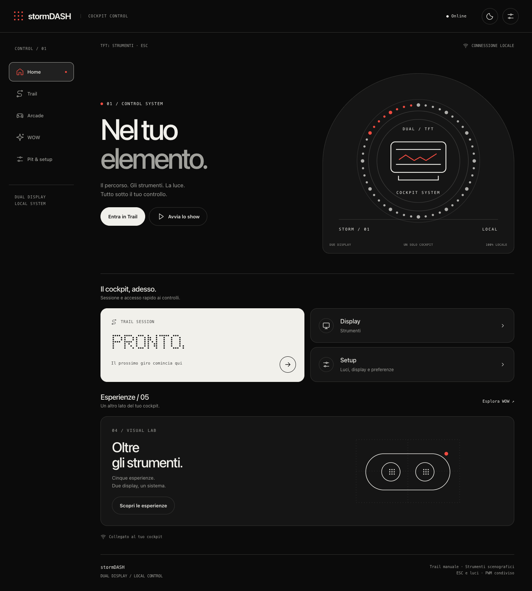

# stormDASH · Industrial UI

Dashboard RC a due display per **ESP32-S3 N16R8**: pilota ST7735 160×80 e copilota ST7789 240×135. Interfaccia locale nel browser, con temi chiaro/scuro, accenti rossi, font a punti e navigazione responsive.

**[Scarica firmware e pacchetto completo](https://github.com/redhorm/esp32-dual-screen-dashboard-CDX-/releases/tag/industrial-2026-11-09)** · [Guida al redesign](docs/UI_INDUSTRIAL.md) · [Tutte le schermate](docs/screenshots)



## Funzioni

- **Home:** panoramica cockpit e accessi rapidi.
- **Trail:** sessioni, tempo, gate, penalità e risultati.
- **Arcade:** gioco e comandi sui TFT.
- **WOW:** cinque esperienze interattive, inclusa riproduzione audio dal telefono.
- **Pit & setup:** strumenti ESC, calibrazione, luci indipendenti, display e diagnostica.

ESC e luci condividono il segnale PWM ma hanno controlli e salvataggi separati. Il dashboard legge il segnale: non comanda motore o servo. Velocità, RPM e cambio sono scenografici. La revisione grafica conserva logica, API e comportamenti della base `7.1.0-rc.7-esc-lights`.

## Installazione

1. Scarica `firmware.bin` dalla release. È un'immagine applicativa per la configurazione ESP32-S3 N16R8 esistente, non un dump completo.
2. Collega il telefono al Wi-Fi del dashboard e apri `http://192.168.4.1`.
3. Termina eventuali sessioni e torna a Strumenti. In **Pit & setup → Aggiorna firmware**, seleziona il file e attendi il riavvio.
4. Riconnettiti e riapri il portale. Il pulsante in alto cambia tema chiaro/scuro.

Foto e impostazioni restano gestite dal sistema OTA esistente. Non applicare questa immagine a schede o partizioni diverse. Il redesign qui pubblicato è compilato e testato; non è stato caricato sulla scheda durante la consegna.

## Compilazione

Richiede Python3, Node.js18+ e PlatformIO. Le dipendenze del firmware sono dichiarate in `platformio.ini`.

```sh
python3 tools/build_portal.py
python3 tools/build_portal.py --check
pio run -e esp32-s3-devkitc-1
```

Il binario si trova in `.pio/build/esp32-s3-devkitc-1/firmware.bin`. HTML, CSS, font e SVG sono incorporati: nessuna connessione Internet necessaria per l'interfaccia sul dispositivo.

## Test

```sh
npm ci
npx playwright install chrome webkit
npm test
npm run test:browser
npm run test:webkit
```

I test browser usano API simulate e non comandano l'hardware. Screenshot e report vengono scritti in `output/test-evidence/` (oppure nella directory indicata da `STORM_TEST_OUTPUT`). Sono inclusi anche i test nativi in `test/`, eseguibili con `pio test -e native`.

Verifiche della consegna:32/32 test di comportamento; integrazione Chrome e WebKit;40 combinazioni sezione/tema/viewport;8 combinazioni della pagina di aggiornamento; build ESP32 riuscita. [Report](docs/validation). Non è una misurazione dei60FPS sul telefono o una prova fisica del PWM.

## Struttura

| Percorso | Contenuto |
|---|---|
| `src/`, `include/` | Firmware e header HTML generati |
| `web/` | Sorgenti dell'interfaccia e design system |
| `assets/portal/` | Illustrazioni e font a punti originale |
| `tools/`, `test/` | Generazione, verifiche browser e test nativi |
| `docs/` | Documentazione, schermate e risultati |
| `references/recoil/` | Coordinate di riferimento delle luci RPM |
| `output/stormDASH/` | HTML generato, che richiede le API del dispositivo |
| `releases/industrial-2026-11-09/` | Manifest e SHA256 del firmware |

`tools/preview_portal.py` e alcuni documenti tecnici sono strumenti storici: la UI attuale è `web/portal.html`. I file di recupero del dispositivo e gli strumenti privati legati alla rete locale non sono distribuiti. Gli screenshot sono catture del browser con dati di prova.
